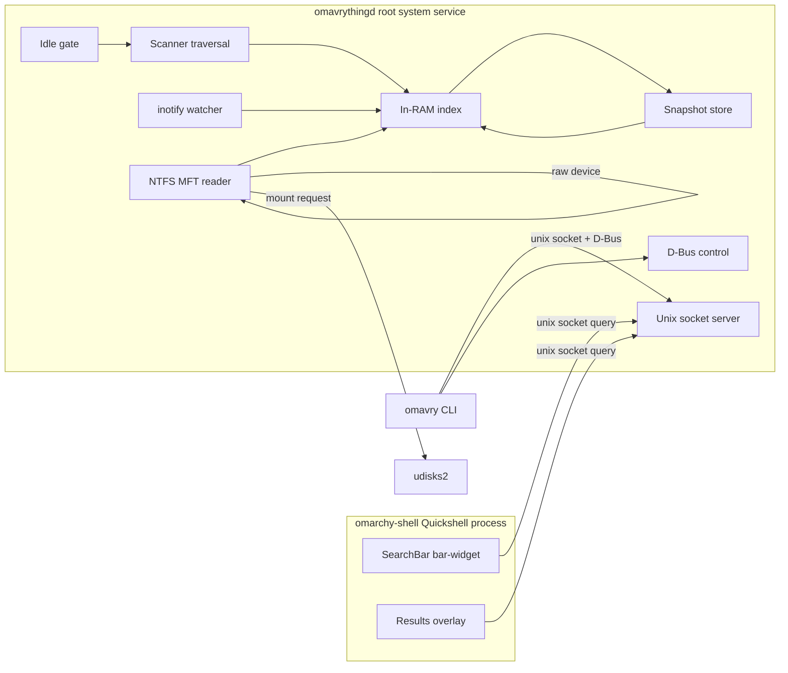
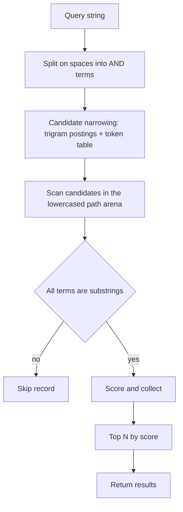
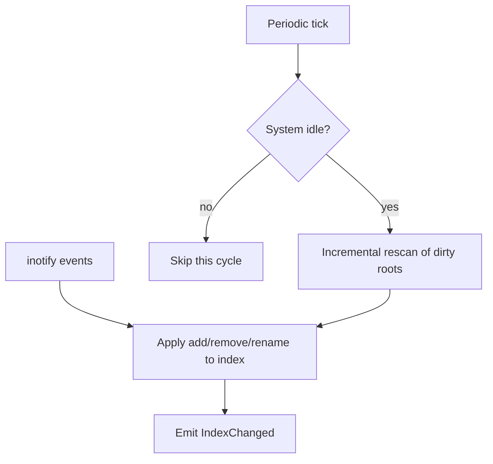
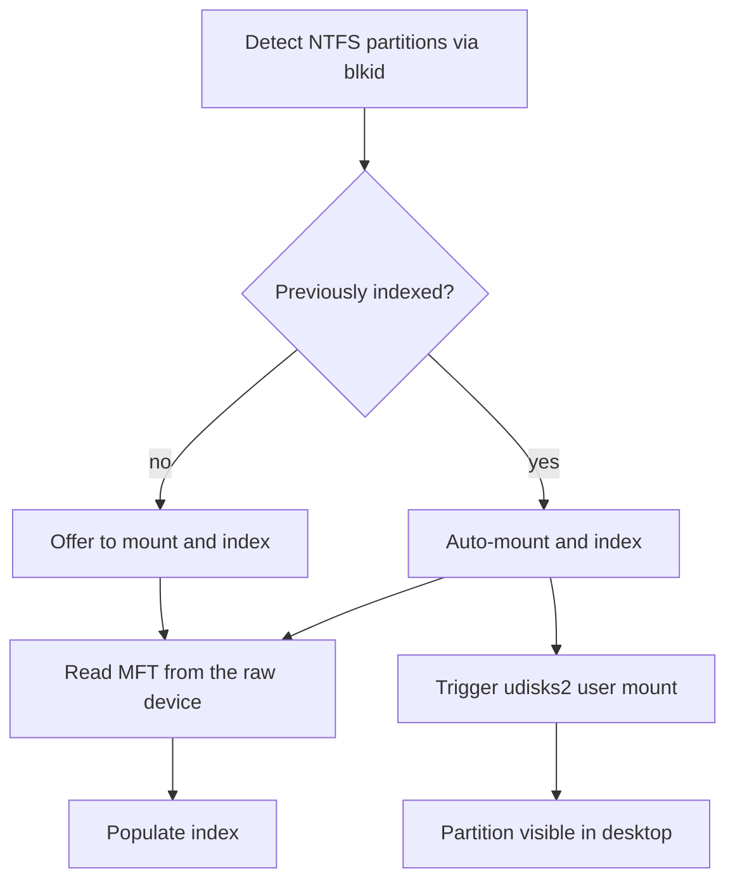
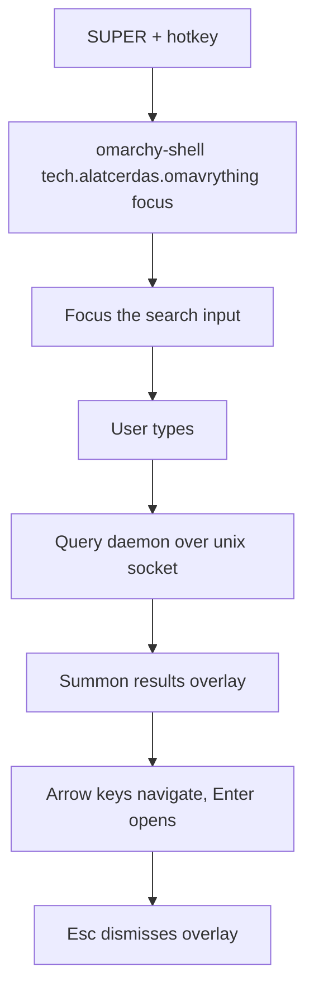

# Architecture

Technical design for `omavrything`, a recreation of Voidtools Everything for
Omarchy Quattro (4.x).

**Target platform:** Omarchy Quattro (4.x) — Hyprland, `omarchy-shell`
(Quickshell/Qt), Arch Linux. No backwards compatibility with earlier Omarchy
releases.

## 1. Design principles

- **Instant results.** The index lives in RAM; a query is a fast linear scan, not
  a disk walk. Target: sub-20 ms for a 1M-file index.
- **Simplicity first.** One daemon, one index, one search path. No distributed
  components, no database engine unless the index outgrows RAM.
- **Performance first.** Compact in-memory records, SIMD-friendly substring
  matching, zero-copy IPC framing, and idle-gated background work.
- **Privilege is isolated to one process.** Only `omavrythingd` runs as root; the
  UI and CLI are unprivileged clients.
- **Fail soft.** If the daemon is down, the UI degrades to an empty state; the
  index is rebuilt from the snapshot or a fresh scan.

## 2. Components



| Component | Crate / artifact | Role |
| --- | --- | --- |
| `omavrything-core` | library | Index, search, scanner, inotify, config, IPC protocol, snapshot. |
| `omavrything-ntfs` | library | Pure-Rust NTFS MFT reader and partition detection. |
| `omavrythingd` | binary | Root system daemon; owns the index and all background work. |
| `omavrything-cli` | binary (`omavry`) | Unprivileged CLI client. |
| `omavrything` shell plugin | QML | Persistent bar search input + floating results overlay. |

## 3. Index model

The index is a flat, cache-friendly structure designed for a single linear scan
per query.

```rust
struct FileRecord {
    parent: u32,      // index of parent directory record
    name_off: u32,    // offset into the name arena
    name_len: u16,    // byte length of the name
    path_off: u32,    // offset into the full-path arena
    path_len: u32,    // byte length of the full path
    size: u64,
    mtime: i64,
    flags: u8,        // is_dir, is_symlink, fs_kind
}

struct Index {
    records: Vec<FileRecord>,   // one per file/dir
    names: Vec<u8>,             // UTF-8 name arena
    paths: Vec<u8>,             // UTF-8 full-path arena
    roots: Vec<Root>,           // indexed mount points
    candidate: CandidateIndex,  // derived: trigram postings, lowercased arena, token table
}
```

- **Full paths are stored** in a single arena so a query scans contiguous memory.
  Memory cost is roughly 100–200 bytes per file; a 1M-file index is ~100–200 MB.
  This is the Everything model and is the primary memory tradeoff (see
  [`memory-optimization.md`](memory-optimization.md)).
- **Directories are records too**, so the tree can be reconstructed and
  incremental updates can splice subtrees.
- **Case folding:** the original path is stored; matching is ASCII
  case-insensitive on the hot path, with a Unicode-aware fallback for non-ASCII
  queries.

## 4. Search



- **Semantics (v0.1):** case-insensitive substring over the full path; multiple
  space-separated terms are ANDed.
- **Candidate narrowing (M23 F1–F3):** a derived `CandidateIndex` narrows the scan
  before matching. A trigram index over path components intersects posting lists
  for each ASCII term of at least three bytes that contains no `/`; a sorted token
  table answers single-token prefix queries by binary search. The candidate set is
  always a **superset** of the matches, so verifying each candidate with the exact
  matcher yields results identical to a linear scan. Terms that are shorter,
  non-ASCII, or contain `/` contribute no constraint, and a query with no
  narrowing term falls back to the full scan.
- **Cache-friendly matching (M23 F2):** each record's full path is stored
  ASCII-lowercased in a contiguous arena, so the hot loop reads one arena instead
  of chasing the record vector and the parent link.
- **Matching:** `memchr`/SIMD substring search per term; the first term filters,
  subsequent terms refine.
- **Ranking:** earlier match position, name match over path-only match, shorter
  path, shallower depth, and recency (mtime) as tie-breakers.
- **Result cap:** the UI requests a bounded top-N (default 100); the daemon never
  materializes the full result set for the UI.
- **Maintenance (M23 F4):** the candidate index is append-only, mirroring the
  record tombstones: inserts and renames append postings and tokens, and stale
  entries are filtered at match time. Compaction and snapshot load rebuild it.
- **Deferred:** regex/glob, whole-word, and content search.

## 5. Scanner (Linux filesystems)

- **Mount discovery:** parse `/proc/mounts` (and `/proc/self/mountinfo`) to
  enumerate mounted filesystems and their types.
- **Traversal:** a parallel directory walker (bounded worker pool) over each
  configured root, skipping pseudo-filesystems (`proc`, `sys`, `dev`, `run`,
  `tmpfs`, `cgroup`, `overlay`) and configured exclude globs.
- **Filesystem kinds:** btrfs, ext4, xfs, f2fs, vfat are all handled by the same
  traversal path; the kind is recorded per root for reporting and for choosing
  the update strategy.
- **Initial scan:** builds the index from scratch; progress is reported over
  D-Bus (`ScanProgress`).
- **Incremental scan:** re-walks a subtree and diffs against the index.

## 6. Live updates and idle gating



- **inotify:** recursive watches per directory; handles `IN_CREATE`,
  `IN_DELETE`, `IN_MOVED_FROM/TO`, `IN_CLOSE_WRITE`, `IN_ATTRIB`. Watch-limit
  exhaustion (`max_user_watches`) is detected and reported; the periodic rescan
  is the safety net.
- **Idle gate:** a rescan only runs when the system is quiet, measured from
  `/proc/loadavg` (1-min load below a threshold), `/proc/stat` CPU idle, and
  `/proc/diskstats` in-flight I/O. The systemd login1 idle hint is used as a
  secondary signal.
- **Periodic rescan:** a low-frequency incremental rescan of roots that received
  no inotify coverage or that are known to change without events (e.g. NTFS
  mounted read-only, network mounts).

## 7. Persistence (snapshot)

- The index is serialized to `/var/lib/omavrything/index.snapshot` on a timer and
  on clean shutdown.
- **Warm start:** on boot the daemon memory-maps/loads the snapshot, then
  validates it against the current mount table and filesystem generation
  (btrfs generation, ext4 superblock, NTFS USN) before trusting it.
- **Staleness:** if a root's identity or generation changed, that root is
  rescanned; the rest of the snapshot is reused.
- **Atomicity:** write to a temp file and `rename()`; keep the previous snapshot
  as a fallback.
- **Format:** a versioned, length-prefixed binary (e.g. `postcard`/`bincode`)
  with a header carrying a format version and a checksum.

## 8. IPC

### 8.1 Unix domain socket (search hot path)

- Path: `/run/omavrything/omavrything.sock`, mode `0660`, group `omavrything`.
- **Framing:** newline-delimited JSON (simple, debuggable, and directly parseable
  from QML). The result set is bounded, so serialization is not the bottleneck.
- **Request:** `{"q":"report","limit":100,"offset":0}`
- **Response:** `{"results":[{"path":"/home/sam/report.pdf","name":"report.pdf","size":1234,"mtime":1699999999,"is_dir":false}],"total":42,"took_ms":7}`
- **Peer identity:** `SO_PEERCRED` identifies the calling user; access is limited
  to members of the `omavrything` group (or all local users, configurable).

### 8.2 D-Bus (control and status)

- **Bus:** system bus. **Name:** `tech.alatcerdas.omavrything`.
  **Path:** `/tech/alatcerdas/omavrything`. **Interface:**
  `tech.alatcerdas.omavrything.Manager`.

| Member | Kind | Description |
| --- | --- | --- |
| `GetStatus` | method | Index size, roots, scan state, memory use. |
| `Rescan` | method | Trigger a full or per-root rescan. |
| `GetConfig` / `SetConfig` | method | Read/write runtime config. |
| `ListRoots` | method | Indexed roots and their filesystem kinds. |
| `MountNtfs` | method | Mount a detected NTFS partition. |
| `IndexChanged` | signal | Emitted after index mutations. |
| `ScanProgress` | signal | Emitted during scans. |

- **polkit:** control methods (`Rescan`, `SetConfig`, `MountNtfs`) are gated by a
  polkit action `tech.alatcerdas.omavrything.control` (`auth_admin_keep`); the
  cosmetic `background_opacity` key uses `tech.alatcerdas.omavrything.set-config`
  (`allow_active=yes`). Both actions carry the
  `org.freedesktop.policykit.owner` annotation for `unix-user:omavrything`, so
  the unprivileged daemon may query polkit for the caller.

## 9. NTFS



- **Detection:** `blkid` (falling back to a boot-sector OEM check) enumerates
  block devices and identifies NTFS partitions by UUID/label.
- **MFT read:** `omavrything-ntfs` reads the MFT directly from the raw block
  device — no mount required for indexing. This is the Everything approach and is
  the fastest path. The reader is a **pure-Rust** implementation (the alternative
  documented in ADR-006), so there is no C dependency or FFI surface.
- **USN journal:** parsing is implemented in `omavrything-ntfs` but **live USN
  updates are deferred to v0.2** (v0.1 uses MFT read-only + periodic rescan).
- **Mounting:** the daemon triggers a **udisks2** mount so the partition appears
  at `/run/media/<user>/<label>` and the desktop sees it. If udisks2 is
  unavailable, the daemon falls back to a private read-only `ntfs3` mount at
  `/run/omavrything/ntfs/<uuid>`.
- **Auto-mount policy:** a partition that was previously enabled and indexed is
  auto-mounted on detection; a newly seen partition is offered (notification +
  D-Bus `MountNtfs`), never silently mounted.

## 10. UI (omarchy-shell plugin)

- **Plugin location:** `~/.config/omarchy/plugins/tech.alatcerdas.omavrything/` (third-party).
- **Manifest:** `kinds: ["bar-widget", "overlay", "service"]`, entry points
  `barWidget: "SearchBar.qml"`, `overlay: "SearchOverlay.qml"`, and
  `service: "Service.qml"`.



- **`SearchBar.qml` (bar-widget):** a persistent **visual mirror** in the bar's
  center section, right of the clock anchor ("right-center aligned"). It shows a
  placeholder when empty and mirrors the query typed in the scratchpad (via the
  runtime file, ADR-014). Clicking it summons the scratchpad. It does **not**
  host the input: the bar surface cannot take keyboard focus (ADR-008).
- **`SearchOverlay.qml` (overlay):** the **centered scratchpad tile** (ADR-012):
  a layer-shell `PanelWindow` with `keyboardFocus: Exclusive` while open,
  containing the input at the top and a results table below. It is **dynamically
  sized**: `widthFraction`/`heightFraction` and `maxWidth`/`maxHeight` are
  hardcoded defaults, and the height grows with
  the result count up to the cap. Keyboard navigation
  (`Up`/`Down`/`PageUp`/`PageDown`/`Enter`), `Esc` dismisses. `Enter` opens the
  selected result, or the top result when no cursor is active. The search field
  is a **custom, non-native input** — a focusable `Item` that renders the query
  with a `Text` element and edits it from `Keys.onPressed` — not a `TextInput`.
  On Qt 6.12 a native editable `TextInput` connects to `QClipboard::dataChanged`
  and synchronously reads the foreign text over the Wayland transfer with no
  aggregate byte limit and no total deadline, so a streaming clipboard owner
  could stall or exhaust the shared shell with no paste action and no field
  focus. A custom input has no clipboard connection at all, so the class cannot
  recur. Because the plugin is `keepLoaded`, the field is still created lazily
  by a `Loader` gated on the open state and torn down on close.
- **`Service.qml` (service):** a headless plugin that owns the persistent
  `tech.alatcerdas.omavrything` IPC target (`focus`, `ping`), so the hotkey works before the
  overlay has ever been loaded (ADR-008).
- **Actions:** `Enter` opens the file; a modifier opens the containing folder;
  another copies the path.
- **Focus:** the bar surface cannot grant keyboard focus to a widget's
  `TextInput`, so the input lives in the companion overlay (ADR-008).
- **Hotkey:** a Hyprland binding (`SUPER, Space`) calls
  `omarchy-shell tech.alatcerdas.omavrything focus`. The plugin registers an IPC
  target `omavrything` with a `focus` method.

## 11. CLI (`omavry`)

A first-class client for scripting and headless use.

```sh
omavry search "report 2024"      # query the daemon
omavry search --json "*.pdf"     # machine-readable output
omavry status                    # index size, roots, scan state
omavry rescan [--root /home]     # trigger a rescan
omavry config get|set <key> <v>  # runtime config
omavry mount <uuid>              # mount a detected NTFS partition
```

## 12. Configuration

`/etc/omavrything/config.toml` (system-wide), with optional per-user overrides
for the UI. Every key is optional; a command-line flag overrides the file, which
overrides the built-in default. Unknown keys are rejected.

```toml
auto = true                            # discover roots from the mount table
roots = ["/home", "/mnt/data"]         # explicit roots (when auto = false)
excludes = ["**/.git/**", "**/node_modules/**"]
scan_interval = 900                    # idle-gated rescan, seconds (0 disables)
snapshot_interval = 300                # snapshot write, seconds (0 disables)
watch = true                           # inotify live updates
dbus = true                            # D-Bus control interface
ntfs = true                            # detect and index NTFS partitions
metadata = true                        # collect per-file size/mtime
log_level = "error"                    # error | warn | info | debug | trace
socket = "/run/omavrything/omavrything.sock"
snapshot = "/var/lib/omavrything/index.snapshot"
```

The daemon logs structured events to stderr (journald-friendly
`field=value` lines); the level is set by `--log-level`, `log_level`, or
`OMAVRYTHING_LOG`. The system service (`data/systemd/omavrythingd.service`) runs
as a dedicated `omavrything` user with a minimal capability set and a hardened
profile; see [`daemon.md`](daemon.md).

## 13. Packaging

- **AUR `PKGBUILD`** builds the workspace and installs `omavrythingd`, the
  systemd unit, the D-Bus policy, the polkit action, the default config, the
  `omavry` CLI, and the shell plugin (to `/usr/share/omavrything/omarchy-shell/`
  with an install helper that copies it into `~/.config/omarchy/plugins/` and
  enables it).
- The shell plugin is installed per-user because `omarchy-shell` loads plugins
  from the user config directory.
