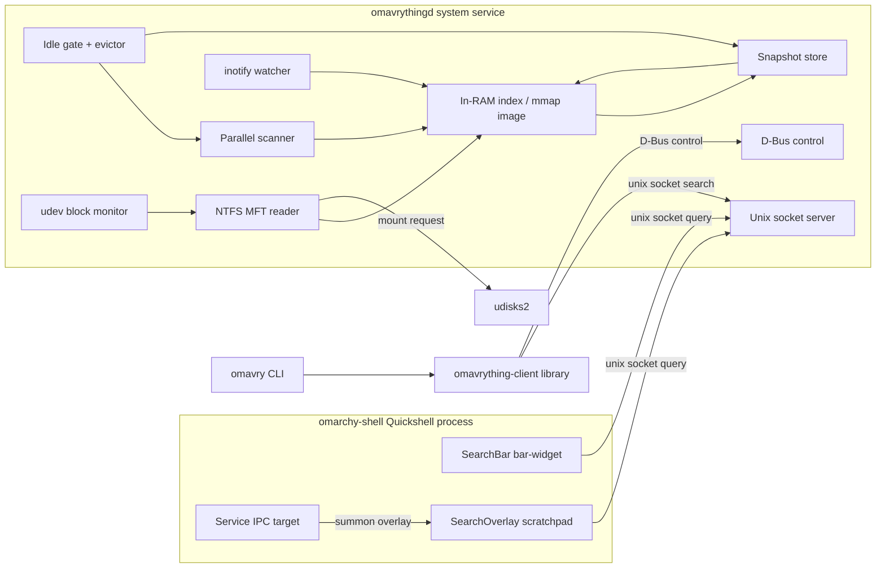
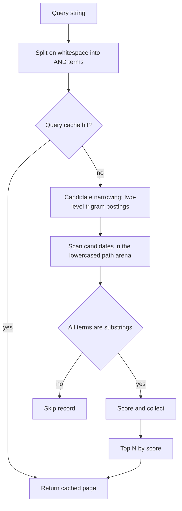
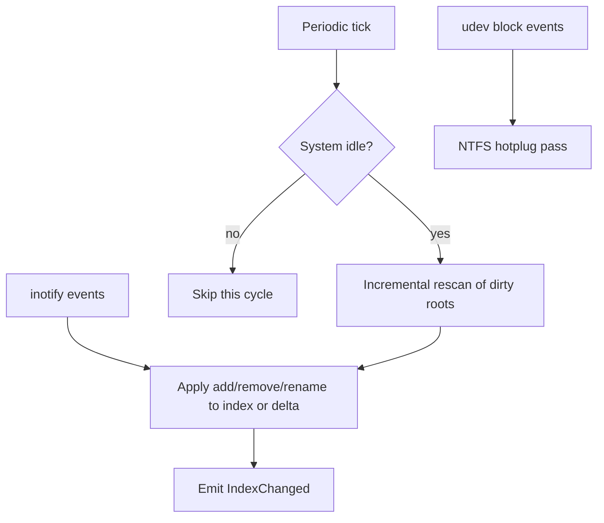
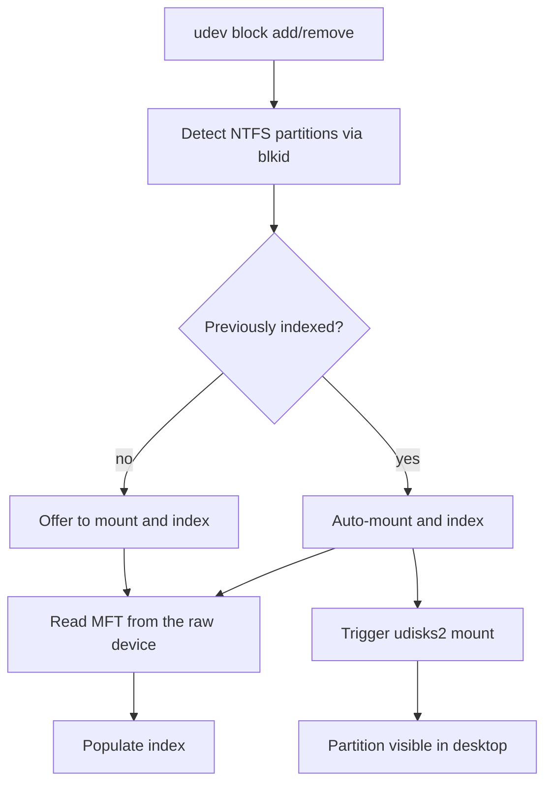
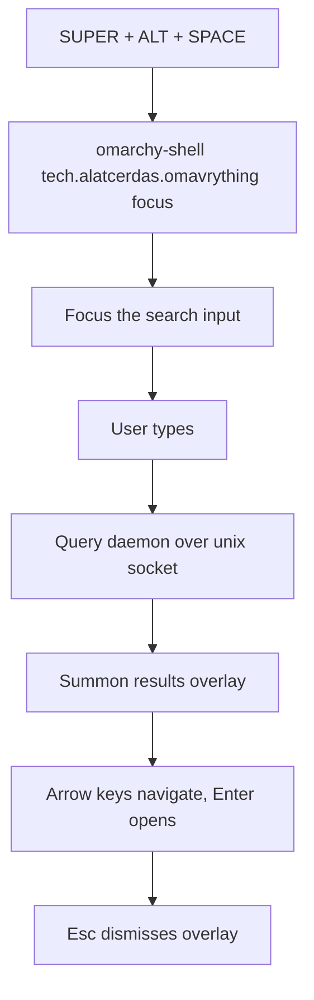

# Architecture

Technical design for `omavrything`, a recreation of Voidtools Everything for
Omarchy Quattro (4.x).

**Target platform:** Omarchy Quattro (4.x) — Hyprland, `omarchy-shell`
(Quickshell/Qt), Arch Linux. No backwards compatibility with earlier Omarchy
releases.

## 1. Design principles

- **Instant results.** The index is resident in RAM while in use; a query is a
  fast scan over compact arenas, not a disk walk. Target: sub-20 ms for a
  1M-file index.
- **Simplicity first.** One daemon, one index, one search path. No distributed
  components, no database engine unless the index outgrows RAM.
- **Performance first.** Compact in-memory records, SIMD-friendly substring
  matching, bounded newline-delimited JSON framing, and idle-gated background
  work.
- **Bounded idle footprint (optional).** An optional, experimental idle-eviction
  feature can release the in-memory index when the user is idle: it evicts the
  owned index to a memory-mapped snapshot image and keeps only the mapping plus a
  small delta, and the next query materializes it again. It is disabled by
  default (`evict_idle_secs = 0`).
- **Privilege is isolated to one process.** Only `omavrythingd` runs as a system
  service, and it runs as the dedicated `omavrything` user with a minimal
  capability set rather than full root. The UI and CLI are unprivileged clients.
- **Fail soft.** If the daemon is down, the UI degrades to an empty state; the
  index is rebuilt from the snapshot or a fresh scan.

## 2. Components



| Component | Crate / artifact | Role |
| --- | --- | --- |
| `omavrything-core` | library | Index, search, scanner, inotify, idle gate, config, IPC protocol, snapshot. |
| `omavrything-ntfs` | library | Pure-Rust NTFS MFT reader, USN record parser, and partition detection. |
| `omavrything-client` | library | Shared Unix-socket and D-Bus clients used by the CLI and other callers. |
| `omavrythingd` | binary | System daemon; owns the index and all background work. |
| `omavrything-cli` | binary (`omavry`) | Unprivileged CLI client. |
| `omavrything` shell plugin | QML | Persistent bar search input, floating results overlay, and IPC service. |

## 3. Index model

The index is a flat, cache-friendly structure designed for a fast scan per
query, with a derived candidate index to narrow that scan when possible.

```rust
struct FileRecord {
    size: u32,        // bytes, saturating at 4 GiB; zero for directories
    mtime: u32,       // Unix seconds; zero when unavailable
    parent: u32,      // index of parent directory record, or u32::MAX for a root
    path_off: u32,    // offset into the path arena
    path_len: u16,    // byte length of the stored path (under 64 KiB)
    depth: u8,        // number of '/' separators, saturating at 255
    flags: u8,        // is_dir, is_symlink, is_deleted
}

struct Index {
    records: Vec<FileRecord>,   // one per file/dir, 20 bytes each
    paths: Vec<u8>,             // UTF-8 path arena
    roots: Vec<Root>,           // indexed mount points and filesystem kinds
    by_path: PathIndex,         // hash(path) -> record index, no path copy
    candidate: CandidateIndex,  // derived: trigram postings + lowercased arena
    cache: QueryCache,          // memoized query results, invalidated on mutation
}
```

- **Directories store their full path; files store only their basename** and
  reference their parent. A file's full path is reconstructed as
  `parent_path + "/" + basename` on demand, so a directory's path is not
  duplicated in every descendant.
- **The record is exactly 20 bytes** (`#[repr(C)]`, asserted at build time), so
  the snapshot can cast the record section directly from the mapping.
- **Deletions are tombstones** (`FLAG_DELETED`). The arena is append-only;
  removed bytes are reclaimed by compaction, which also rebuilds the derived
  candidate index.
- **`PathIndex`** maps a 32-bit FNV-1a hash of the full path to a record index
  and confirms matches against the path arena. Hash collisions fall back to a
  small `HashMap<Box<str>, u32>`, so the common case does not duplicate path
  bytes.
- **Memory cost** is dominated by the path arenas, the path map, and the
  candidate index rather than the 20-byte records. Budget roughly a few hundred
  bytes per file; see [`memory-optimization.md`](memory-optimization.md).
- **Case folding:** the original path is stored; matching is ASCII
  case-insensitive on the hot path, with a Unicode-aware fallback for non-ASCII
  queries.

## 4. Search



- **Semantics:** case-insensitive substring over the full path; multiple
  space-separated terms are ANDed.
- **Candidate narrowing:** a derived `CandidateIndex` narrows the scan before
  matching. It uses a **two-level trigram index**:
  - **Level 1** records the trigrams of each record's basename, once per record.
  - **Level 2** records the trigrams of each directory's name, once per
    directory. A directory's trigrams apply to its whole descendant range, which
    is stored as a subtree range and expanded at lookup time.
  - A query term that is ASCII, at least three bytes long, and free of `/`
    cannot span a separator, so intersecting its trigram posting lists yields a
    **superset** of the matches. Terms that are shorter, non-ASCII, or contain
    `/` contribute no constraint, and a query with no narrowing term falls back
    to the full scan.
  - Postings are stored in a flat CSR layout with delta- and varint-encoded
    record indices. Very common trigrams are **stop-listed** (their posting list
    is dropped) so they contribute no constraint and the candidate set stays a
    superset.
- **Lowercased arena:** each record's stored path is kept ASCII-lowercased in a
  contiguous arena, so the hot loop reads one arena instead of chasing the
  record vector and the parent link.
- **Matching:** `memchr`/`memmem` SIMD substring search per term; the first term
  filters, subsequent terms refine.
- **Parallel scan:** above 50,000 records the scan is chunked across the rayon
  pool; below that the thread-pool overhead outweighs the gain.
- **Ranking:** name match over path-only match, earlier match position, shorter
  path, shallower depth, and recency (mtime) as tie-breakers.
- **Result cap:** the UI requests a bounded top-N (default 100, hard cap 1000);
  the daemon never materializes the full result set for the UI.
- **Query cache:** repeated identical `(query, limit, offset)` requests are
  memoized and invalidated by any index mutation. It can be disabled with
  `--no-query-cache` for cold-path measurement.
- **Maintenance:** the candidate index is append-only, mirroring the record
  tombstones: inserts and renames append postings, and stale entries are filtered
  at match time. Compaction and snapshot load rebuild it.
- **Deferred:** regex/glob search, whole-word, and content search.

## 5. Scanner (Linux filesystems)

- **Mount discovery:** parse `/proc/mounts` (primary enumeration) and
  `/proc/self/mountinfo` (device identity) to enumerate mounted filesystems and
  their types.
- **Traversal:** a parallel directory walker (bounded rayon pool) over each
  configured root, skipping pseudo-filesystems (`proc`, `sys`, `dev`, `tmpfs`,
  `cgroup`, `overlay`, `squashfs`, and network filesystems) and configured
  exclude globs.
- **Filesystem kinds:** btrfs, ext4, xfs, f2fs, vfat, and NTFS are mapped to an
  `FsKind`; the kind is recorded per root for reporting and update strategy.
- **Removable media:** the generic walker does not descend into `/run/media`
  (ADR-018). Removable volumes are indexed through the NTFS MFT path or a
  targeted rescan of a volume the user explicitly mounted.
- **Network filesystems:** never auto-indexed; a targeted traversal is
  time-boxed (30 s) so a stalled mount cannot block a scan.
- **Initial scan:** builds the index from scratch; progress is reported over
  D-Bus (`ScanProgress`).
- **Rescan:** the walk is split into a `plan_rescan` phase (filesystem I/O,
  outside the index lock) and an `apply_rescan` phase (in-memory reconciliation
  under the lock). A rescan is cancellable when a newer scan supersedes it or
  the daemon shuts down.
- **Metadata:** `metadata = false` skips per-file `stat`, using only `readdir`'s
  `d_type`; directories are still stat'd so nested mounts are not crossed.

## 6. Live updates and idle gating



- **inotify:** recursive watches per directory; handles `IN_CREATE`,
  `IN_DELETE`, `IN_MOVED_FROM/TO`, `IN_CLOSE_WRITE`, `IN_ATTRIB`,
  `IN_DELETE_SELF`, and `IN_MOVE_SELF`. `MOVED_FROM`/`MOVED_TO` pairs are
  matched by cookie so a rename becomes one event; a move out of the watched
  tree becomes a removal after a short pairing window. Watch-limit exhaustion
  (`ENOSPC`) is recorded and reported; the periodic rescan is the safety net.
- **Idle gate:** a rescan only runs when the system is quiet, measured from
  `/proc/loadavg` (1-min load below a threshold), `/proc/stat` CPU idle, and
  `/proc/diskstats` in-flight I/O. The systemd login1 idle hint is used as a
  secondary signal.
- **Periodic rescan:** a low-frequency incremental rescan of roots that received
  no inotify coverage or that are known to change without events (e.g. NTFS
  mounted read-only).
- **Idle eviction (optional, experimental):** when enabled
  (`evict_idle_secs > 0`), after that many seconds without user activity the
  owned index is encoded to the snapshot and replaced by a memory-mapped image
  plus a resident path map. Filesystem events accumulate in a `DeltaIndex` while
  evicted; a query returns `state: "loading"` and starts a background
  materialization. Disabled by default.
- **udev hotplug:** a netlink monitor wakes the NTFS pass on block-device
  add/remove/change events, with a polling fallback if the socket cannot be
  opened.

## 7. Persistence (snapshot)

- The index is serialized to `/var/lib/omavrything/index.snapshot` on a timer,
  on clean shutdown, and when the idle evictor runs.
- **Format (v6):** a versioned, directly mappable binary image:
  - magic `OMAVIMG\0`, format version, header length, and section count;
  - a section table for `ROOTS`, `RECORDS`, `PATHS`, and `ROOT_STRINGS`;
  - the `RECORDS` section is a contiguous `#[repr(C)]` `FileRecord` array, so
    loading is an `mmap` plus header validation with no decode or rebuild;
  - an FNV-1a checksum over the body.
- **Warm start:** on boot the daemon memory-maps the snapshot, then validates
  each root against the current mount table and filesystem identity
  (`st_dev`, btrfs subvolume generation, and the root directory's mtime as a
  non-btrfs staleness watermark) before trusting it.
- **Staleness:** if a root's identity or generation changed, that root is
  rescanned; the rest of the snapshot is reused.
- **Atomicity:** write to a temp file and `rename()`; the previous snapshot is
  kept as `<path>.prev` and used as a fallback.
- **Eviction:** the same image backs the idle-evicted state, so a query can
  materialize the index without a fresh scan.

## 8. IPC

### 8.1 Unix domain socket (search hot path)

- Path: `/run/omavrything/omavrything.sock`, mode `0660`, group `omavrything`.
  A user-run daemon defaults to `$XDG_RUNTIME_DIR/omavrything.sock`.
- **Framing:** newline-delimited JSON (simple, debuggable, and directly parseable
  from QML). The result set is bounded, so serialization is not the bottleneck.
  A request line is capped at 64 KiB.
- **Request:** `{"q":"report","limit":100,"offset":0}`. `method` defaults to
  `search`; `limit` defaults to 100 and is capped at 1000.
- **Response:** `{"results":[{"path":"/home/sam/report.pdf","name":"report.pdf","size":1234,"mtime":1699999999,"is_dir":false}],"total":42,"took_ms":7}`.
  An `error` field is present on failure; a `state` field is `"loading"` while
  an evicted index is being materialized.
- **Peer identity:** `SO_PEERCRED` identifies the calling user; access is
  limited to root, the daemon's own uid, and members of the `omavrything` group.
  If the group does not exist, the socket's file permissions are the only gate.
- **Connection limits:** at most 8 concurrent client threads, with 30 s read and
  write timeouts.

### 8.2 D-Bus (control and status)

- **Bus:** system bus. **Name:** `tech.alatcerdas.omavrything`.
  **Path:** `/tech/alatcerdas/omavrything`. **Interface:**
  `tech.alatcerdas.omavrything.Manager`.

| Member | Kind | Description |
| --- | --- | --- |
| `GetStatus` | method | Version, entries, roots, memory breakdown, scan state, errors, uptime. |
| `Rescan` | method | Trigger a full or per-root rescan; returns entries added. |
| `GetConfig` / `SetConfig` | method | Read/write runtime config. |
| `ListRoots` | method | Indexed root paths. |
| `ListVolumes` | method | Detected block volumes with UUID, label, fstype, mount point, and status. |
| `MountNtfs` | method | Mount an NTFS partition by UUID and index it. |
| `MountVolume` | method | Mount any volume by device path and index it. |
| `UnmountVolume` | method | Unmount a volume and drop its index entries. |
| `IndexChanged` | signal | Emitted after index mutations; carries the live entry count. |
| `ScanProgress` | signal | Emitted during scans; carries phase, entries, and error count. |

- **polkit:** privileged control methods (`Rescan`, `SetConfig` for non-cosmetic
  keys, `MountNtfs`, `MountVolume`, `UnmountVolume`) are gated by
  `tech.alatcerdas.omavrything.control` (`auth_admin_keep`). The cosmetic
  `background_opacity` key uses `tech.alatcerdas.omavrything.set-config`
  (`allow_active=yes`). Both actions carry the
  `org.freedesktop.policykit.owner` annotation for `unix-user:omavrything`, so
  the unprivileged daemon may query polkit for the caller.

## 9. NTFS



- **Detection:** `blkid -o export` enumerates block devices and identifies NTFS
  partitions by UUID/label, with a boot-sector OEM check as a dependency-free
  fallback. A udev netlink monitor triggers the hotplug pass on block-device
  changes.
- **MFT read:** `omavrything-ntfs` reads the MFT directly from the raw block
  device — no mount required for indexing. This is the Everything approach and is
  the fastest path. The reader is a **pure-Rust** implementation (ADR-006), so
  there is no C dependency or FFI surface.
- **USN journal:** parsing is implemented in `omavrything-ntfs`, but live USN
  updates are **not wired into the index yet**; the daemon uses an MFT read plus
  the periodic rescan.
- **Mounting:** the daemon prefers the **udisks2 D-Bus API**, falls back to
  `udisksctl`, and finally to a private read-only `ntfs3` mount at
  `/run/omavrything/ntfs/<uuid>`. A pre-existing writable mount (a udisks2
  auto-mount at login) is remounted read-only and kept read-only, so the MFT
  read cannot set the volume's dirty bit (B12). The generic walker never indexes
  `/run/media` (ADR-018).
- **Mount ownership:** the daemon records which mounts it created in a
  `mounts.state` file, unmounts only those on shutdown, reconciles the state on
  restart, and drops a mount's index entries when the mount disappears.
- **Auto-mount policy:** a partition that was previously enabled and indexed is
  auto-mounted on detection; a newly seen partition is offered (notification +
  D-Bus `MountNtfs`), never silently mounted.

## 10. UI (omarchy-shell plugin)

- **Plugin location:** `~/.config/omarchy/plugins/tech.alatcerdas.omavrything/`
  (third-party).
- **Manifest:** `kinds: ["bar-widget", "overlay", "service"]`, `keepLoaded:
  true`, entry points `barWidget: "shell/omavrything/SearchBar.qml"`,
  `overlay: "shell/omavrything/SearchOverlay.qml"`, and
  `service: "shell/omavrything/Service.qml"`.



- **`SearchBar.qml` (bar-widget):** a persistent **visual mirror** in the bar's
  center section, right of the clock anchor. It shows a placeholder when empty
  and mirrors the query typed in the scratchpad (via the runtime file, ADR-014).
  Clicking it summons the scratchpad. It does **not** host the input: the bar
  surface cannot take keyboard focus (ADR-008).
- **`SearchOverlay.qml` (overlay):** the **centered scratchpad tile** (ADR-012):
  a layer-shell `PanelWindow` with `keyboardFocus: Exclusive` while open,
  containing the input at the top and a results table below. It is **dynamically
  sized**: `widthFraction`/`heightFraction` and `maxWidth`/`maxHeight` are
  hardcoded defaults, and the height grows with the result count up to the cap.
  Keyboard navigation (`Up`/`Down`/`PageUp`/`PageDown`/`Enter`), `Esc` dismisses.
  `Enter` opens the selected result, or the top result when no cursor is active.
  The search field is a **custom, non-native input** — a focusable `Item` that
  renders the query with a `Text` element and edits it from `Keys.onPressed` —
  not a `TextInput`. On Qt 6.12 a native editable `TextInput` connects to
  `QClipboard::dataChanged` and synchronously reads foreign text over the Wayland
  transfer with no aggregate byte limit and no total deadline, so a streaming
  clipboard owner could stall or exhaust the shared shell with no paste action
  and no field focus. A custom input has no clipboard connection at all, so the
  class cannot recur. Because the plugin is `keepLoaded`, the field is still
  created lazily by a `Loader` gated on the open state and torn down on close.
- **Results table:** shows name, size, modified time, and path so duplicate
  names are distinguishable. Column headers re-sort the current page
  client-side; the daemon's ranking is the default order.
- **Settings panel:** reads and writes daemon configuration through the
  `omavry` CLI (which speaks the polkit-gated D-Bus interface), and lists
  detected volumes with mount/unmount actions.
- **`Service.qml` (service):** a headless plugin that owns the persistent
  `tech.alatcerdas.omavrything` IPC target (`focus`, `ping`), so the hotkey works
  before the overlay has ever been loaded (ADR-008).
- **Actions:** `Enter` opens the selected file with `xdg-open`; the results table
  shows the containing folder and full path so duplicate names are
  distinguishable.
- **Hotkey:** a Hyprland binding (`SUPER + ALT + SPACE`) calls
  `omarchy-shell tech.alatcerdas.omavrything focus`. The plugin registers an IPC
  target `tech.alatcerdas.omavrything` with a `focus` method.

## 11. CLI (`omavry`)

A first-class client for scripting and headless use. It uses the shared
`omavrything-client` library: `search` over the Unix socket and the control
commands over D-Bus.

```sh
omavry search "report 2024"          # query the daemon
omavry search --json "report"        # machine-readable output
omavry status [--json]               # index size, roots, scan state
omavry rescan [--root /home]         # trigger a rescan
omavry volumes [--json]              # detected volumes and status
omavry mount <uuid>                  # mount and index an NTFS partition
omavry mount-volume <device>         # mount and index any volume
omavry unmount-volume <device>       # unmount a volume and drop its index
omavry config get [--json]           # read runtime config
omavry config set <key> <value>      # write runtime config
```

`search` retries briefly while the daemon reports `state: "loading"`, so an
evicted index does not produce a misleading empty page.

## 12. Configuration

`/etc/omavrything/config.toml` (system-wide). A user-run daemon accepts the same
keys. Every key is optional; a command-line flag overrides the file, which
overrides the built-in default. Unknown keys are rejected. Runtime changes made
through D-Bus are persisted to a separate **state** file
(`/var/lib/omavrything/config.toml` for the system service), so the shipped
config is never rewritten.

```toml
auto = true                            # discover roots from the mount table
roots = ["/home", "/mnt/data"]         # explicit roots (when auto = false)
volumes = ["/dev/sda1"]                # volumes mounted through the settings UI
excludes = ["**/.git/**", "**/node_modules/**", "**/.cache/**"]
scan_interval = 900                    # idle-gated rescan, seconds (0 disables)
snapshot_interval = 300                # snapshot write, seconds (0 disables)
evict_idle_secs = 0                    # optional idle eviction, seconds (0 disables; default 0)
watch = true                           # inotify live updates
dbus = true                            # D-Bus control interface
ntfs = true                            # detect and index NTFS partitions
metadata = true                        # collect per-file size/mtime
candidate_index = true                 # build/consult the trigram candidate index
background_opacity = 0.75              # scratchpad tile opacity (UI setting)
log_level = "error"                    # error | warn | info | debug | trace
socket = "/run/omavrything/omavrything.sock"
snapshot = "/var/lib/omavrything/index.snapshot"
```

The daemon logs structured events to stderr (journald-friendly `field=value`
lines); the level is set by `--log-level`, `log_level`, or `OMAVRYTHING_LOG`.
The system service (`data/systemd/omavrythingd.service`) runs as the dedicated
`omavrything` user with `CAP_DAC_READ_SEARCH` and `CAP_SYS_ADMIN`, a hardened
profile, and a shared mount namespace so its read-only NTFS mounts are visible to
the desktop; see [`daemon.md`](daemon.md).

## 13. Packaging

- **AUR `PKGBUILD`** builds the workspace and installs `omavrythingd`, the
  `omavry` CLI, the systemd unit, the sysusers/tmpfiles drop-ins, the D-Bus
  policy, the polkit action, the default config, the man page, and the shell
  plugin under `/usr/share/omavrything/` (`manifest.json` plus
  `shell/omavrything/`).
- The daemon is **not enabled automatically**; the user chooses whether to run
  it as a system service or as a user process.
- The shell plugin is installed system-wide but loaded per-user: the user copies
  it into `~/.config/omarchy/plugins/tech.alatcerdas.omavrything/` (the
  post-install message and `scripts/install.sh` do this).
